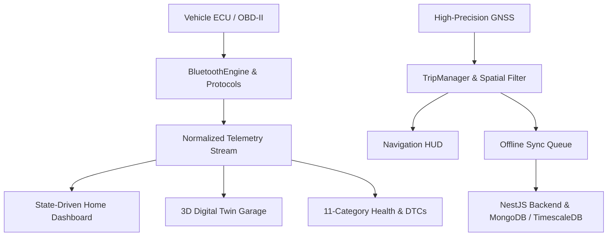

# 🏍️ RideOS Pro — Intelligent Connected Vehicle Mobility Platform

> **Production-Grade Motorcycle Companion Platform: Real Bluetooth Telemetry, 3D Digital Twin, Navigation, Diagnostics & Health**

---

## 🌟 Architecture Overview

**RideOS Pro** is an automotive-grade connected vehicle platform designed for high-performance motorcycles. It interfaces directly with vehicle ECUs and BLE adapters (Yamaha Y-Connect, Ducati Link, OBD-II CAN-BUS), streaming normalized real-time telemetry into a 3D digital twin showroom, precision turn-by-turn navigation HUD, 11-category health monitor, and offline-first trip recorder.



---

## 🚀 Key Modules & Capabilities

1. **Production Bluetooth & Protocol Engine**:
   - Filtered BLE device discovery and auto-reconnection.
   - Dedicated protocol adapters for **Yamaha Y-Connect**, **Ducati Multimedia**, **OBD-II (ELM327)**, and **Generic BLE**.
   - Zero blind writes: safety gated by vehicle speed and verified command capabilities.
2. **Normalized Vehicle Telemetry**:
   - Standardized schema for speed, RPM, battery bus voltage, fuel level, gear, coolant temperature, lean angle, and DTC fault codes.
   - Strict truthful state policy: missing or offline sensors report `Unavailable` rather than synthetic fallback values.
3. **3D Virtual Garage Studio**:
   - Photorealistic motorcycle GLB assets (`yamaha_r1m.glb`, `ducati_panigale.glb`, `bmw_m1000rr.glb`).
   - Adaptive graphics quality (`Auto`, `High Fidelity 60FPS`, `Performance`).
4. **Precision Navigation & Active Ride Recording**:
   - Turn-by-turn guidance ribbon, POI search, and voice guidance synthesizer.
   - Spatial GPS batching with offline persistence and automatic cloud synchronization.
5. **Vehicle Health, Diagnostics & Maintenance**:
   - 11-category health analyzer (Engine, Battery, Fuel, Brakes, Tyres, Lights, Electrical, Cooling, Suspension, Transmission, General).
   - SAE standard DTC dictionary with fault severity grading and clear gates.
   - Odometer-based service reminder calculator.
6. **Production App Shell & Notification Center**:
   - 5-step interactive onboarding flow.
   - Structured notification center with category filter chips and actionable deep links.
   - App settings hub for units (Metric / Imperial), graphics quality, and data export.

---

## 🛠️ Technology Stack

- **Mobile Client**: Flutter 3.29.x / Dart 3.7.x, Riverpod, BLoC, Clean Architecture.
- **Backend API**: NestJS 10.x, TypeScript, Node.js 20.x.
- **Databases**: MongoDB (Profiles, Vehicles, Diagnostics, Maintenance) & TimescaleDB (Telematics).
- **Security**: JWT authentication, AES-GCM encrypted native storage, strictly scoped user ownership.

---

## 📂 Repository Structure

```
RideOS-AI/
├── apps/
│   ├── mobile/                  # Flutter Mobile & Web Client
│   │   ├── android/             # Android Native Layer (Gradle, R8, Manifest, Keystore config)
│   │   ├── lib/
│   │   │   ├── core/            # Bluetooth, Vehicle Protocols, Health, Settings, Notifications
│   │   │   └── features/        # Home, Garage, Navigation, Diagnostics, Maintenance, Trips
│   │   └── test/                # 63 Unit, Golden & Integration Tests
│   └── backend/                 # NestJS API Backend Server
│       ├── src/                 # Auth, Riders, Vehicle Health, Trips, Maps, Telematics
│       └── test/                # 39 Unit & Integration Tests
├── docs/                        # Subsystem Architecture & Compliance Documentation
└── docker-compose.prod.yml      # Production Multi-Service Container Orchestration
```

---

## 🚦 Getting Started

### 1. Prerequisites
- **Node.js**: >= 20.x
- **pnpm**: >= 8.x
- **Flutter SDK**: >= 3.29.0
- **Java**: JDK 17 LTS

### 2. Environment Setup
Copy the environment template and configure database / API credentials:
```bash
cp .env.example .env
```

### 3. Install Dependencies
```bash
pnpm install
cd apps/mobile && flutter pub get && cd ../..
```

### 4. Running Backend Server
```bash
pnpm --filter backend start:dev
```

### 5. Running Mobile / Web App
```bash
cd apps/mobile
flutter run
```

---

## 🧪 Testing & Release Build

### Run Automated Tests
```bash
# Run backend tests (39 tests)
pnpm --filter backend test

# Run mobile tests (63 tests)
cd apps/mobile && flutter test
```

### Build Production Releases
```bash
# Build Web Release Bundle
cd apps/mobile && flutter build web --release --no-tree-shake-icons

# Build Android App Bundle (.aab)
cd apps/mobile && flutter build appbundle --release

# Build Backend Production Bundle
pnpm --filter backend build
```

---

## 📚 Technical Documentation

- [System Architecture](docs/architecture.md)
- [Bluetooth & BLE Subsystem](docs/bluetooth.md)
- [Vehicle Protocols & Telemetry](docs/vehicle-protocols.md)
- [Maps & Navigation](docs/maps.md)
- [3D Assets & Performance](docs/3d-assets.md)
- [Android Build & Release](docs/android.md)
- [Production Deployment](docs/deployment.md)
- [Testing & QA Matrix](docs/testing.md)
