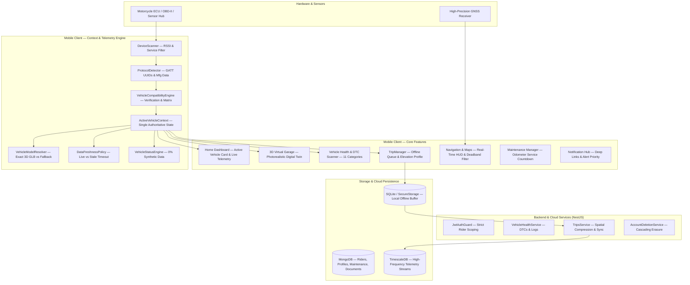

# RideOS Complete System Architecture

## 1. Global End-to-End Architecture



---

## 2. Active Vehicle Context Synchronization

Every screen in RideOS Pro observes a single unified `ActiveVehicleContext` instance:

```dart
class ActiveVehicleContext {
  final String vehicleId;
  final VehicleProfile? profile;
  final VehicleConnectionStatus connectionStatus;
  final VehicleModelStatus modelStatus;
  final String model3DPath;
  final List<String> supportedCapabilities;
  final NormalizedTelemetry telemetry;
  final TelemetryQuality telemetryQuality;
  final List<String> activeDtcCodes;
  final String? activeTripId;
  final DateTime lastUpdated;
}
```

### Data Freshness Policy
- **`LIVE`**: Telemetry packet received $\le$ 3.5 seconds ago.
- **`STALE`**: No update in $>$ 3.5 seconds (displays informative stale warning).
- **`UNAVAILABLE`**: Sensor unmapped or Bluetooth connection inactive (displays explicit `Unavailable` badge).
- **`INVALID`**: Range check or checksum validation failed.

---

## 3. Vehicle Switching & Multi-Vehicle Isolation
- Switching from Vehicle A to Vehicle B atomically unloads active 3D WebGL meshes, resets live telemetry, clears DTC caches, and associates trips and maintenance strictly with the new vehicle ID.
