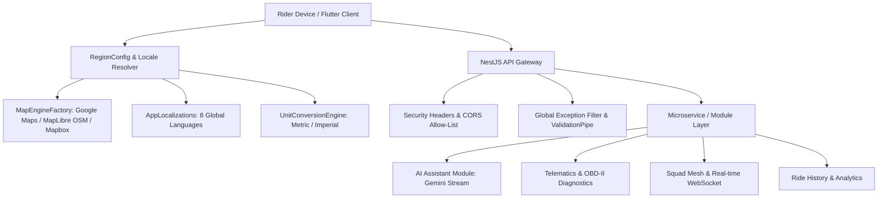

# RoadOS AI — Scalability & Multi-Region System Architecture

> **Architectural Blueprint for Scaling from Single-Rider Prototype to Global Mobility Platform**

---

## 1. Architectural Tiers of Scalability

---

## 2. Dynamic Provider Abstraction Pattern

The platform avoids country-specific hardcoding via interface abstraction:
1. **Map Engine Interface (`IMapEngineController`)**: Dynamically resolves `GoogleMapsProvider`, `MapLibreOsmEngine`, or `MapboxEngine` with automatic failover.
2. **Regional Format Engine (`RegionConfig`)**: Converts speed (km/h ↔ mph), distance (km ↔ mi), pressure (PSI ↔ bar ↔ kPa), and temperature (°C ↔ °F) on the fly based on user locale preferences.
3. **Conversational Copilot Gateway**: Connects to Google Gemini API via backend proxy, keeping API keys 100% server-side and supporting intent action routing.

---

## 3. Deployment Scaling Strategy

- **Stage 1 (City / Regional Pilot)**: Single NestJS node on Cloud Run / ECS with managed PostgreSQL and Redis for pub/sub session state.
- **Stage 2 (National Deployment)**: Multi-region container instances behind Cloudflare CDN and Global Load Balancers with read replicas.
- **Stage 3 (Global Mesh)**: Edge routing for WebSocket telematics and regional data sovereignty compliance (EU data residing in EU AWS/GCP regions).
